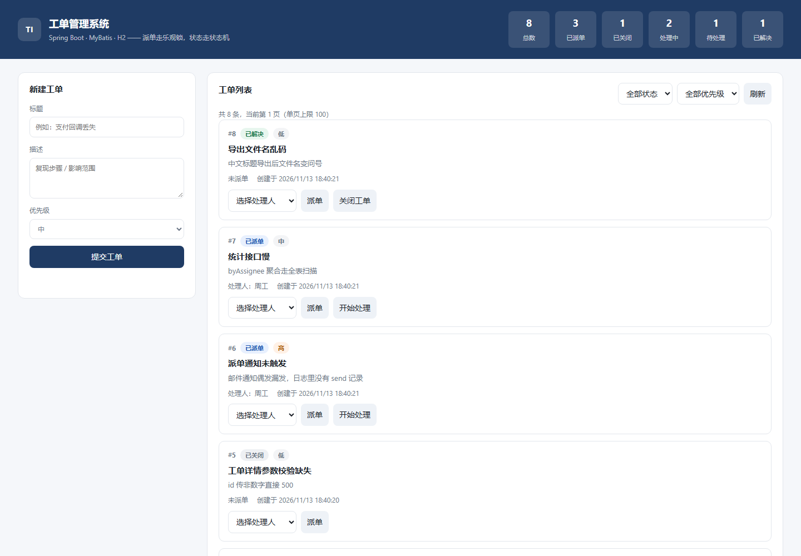

# 工单管理系统（ticket-service）

一个 Spring Boot + MyBatis 写的工单服务：建单、派单、状态流转、统计、分页筛选，附带一个不依赖构建步骤的网页看板。

状态机、乐观锁下的并发控制、分页与索引、避免 N+1、可测的异常契约，这五件事都在这一套代码里，并且都有用例盯着。



## 技术栈

| 层 | 选型 | 说明 |
| --- | --- | --- |
| 运行时 | JDK 17 | |
| Web | Spring Boot 3.2.5（spring-boot-starter-web / validation） | |
| 持久层 | MyBatis 3.0.3 + XML 映射 | SQL 手写，方便讲清索引与分页 |
| 数据库 | H2（内存，`MODE=MySQL`） | 启动即建表灌种子数据，克隆下来就能跑 |
| 测试 | JUnit 5 + MockMvc | 18 个接口用例 + 1 个并发用例 |
| 前端 | 原生 HTML/CSS/JS | 没有 node_modules，静态文件由 Spring Boot 直接托管 |

## 快速开始

```bash
mvn test          # 18 个用例
mvn spring-boot:run
# 打开 http://localhost:8080/
```

或者打包成单个 jar：

```bash
mvn -DskipTests package
java -jar target/ticket-service-1.0.0.jar --server.port=8080
```

启动时会执行 `src/main/resources/db/schema.sql` 和 `data.sql`，建 3 张表、4 个处理人（其中 1 个已停用，用来测派单校验）。

> Windows 上如果 `java.io.tmpdir` 不可写，Tomcat 建临时目录会抛
> `Unable to create tempDir`，指定一个可写目录即可：`java -Djava.io.tmpdir=D:/tmp -jar ...`。

## 接口

| 方法 | 路径 | 说明 |
| --- | --- | --- |
| POST | `/api/tickets` | 建单。`title` 必填且 ≤120 字，`description` ≤2000 字，`priority` 缺省 MEDIUM |
| GET | `/api/tickets/{id}` | 详情 |
| GET | `/api/tickets?status=&priority=&assigneeId=&page=&size=` | 分页列表，`size` 上限 100 |
| POST | `/api/tickets/{id}/assign` | 派单，body `{"assigneeId":2,"note":"..."}` |
| POST | `/api/tickets/{id}/status` | 状态流转，body `{"status":"IN_PROGRESS","note":"..."}` |
| GET | `/api/stats` | 按状态 / 优先级 / 处理人聚合 |
| GET | `/api/assignees` | 处理人列表 |

```console
$ curl -s -X POST http://localhost:8080/api/tickets \
    -H 'Content-Type: application/json' \
    --data-binary '{"title":"支付回调偶发丢失","priority":"URGENT"}'
{"id":1,"title":"支付回调偶发丢失","description":null,"priority":"URGENT","status":"OPEN",
 "assigneeId":null,"version":0,"createdAt":"2026-11-13T18:40:01.373743",
 "updatedAt":"2026-11-13T18:40:01.373743","resolvedAt":null,"assigneeName":null}
```

> **PowerShell 用户注意**：`curl.exe -d '{"a":1}'` 里的双引号会被 PowerShell 吃掉，
> 结果服务端收到非法 JSON 而返回 400。用 `--data-binary "@body.json"` 从文件读，或者用 `Invoke-RestMethod`。

错误响应统一为：

```json
{"code":"VALIDATION_FAILED","message":"参数校验失败","details":{"title":"标题不能为空"},
 "timestamp":"2026-11-13T17:39:56.552Z"}
```

| HTTP | code | 场景 |
| --- | --- | --- |
| 400 | `VALIDATION_FAILED` | 字段缺失 / 超长 / 非法优先级 / 非法状态 |
| 404 | `NOT_FOUND` | 工单或处理人不存在 |
| 409 | `CONFLICT` | 重复派单、派给已停用的处理人、非法状态流转、乐观锁冲突 |

## 状态机

```
OPEN ──► ASSIGNED ──► IN_PROGRESS ──► RESOLVED ──► CLOSED
  │         │  ▲           │  ▲          │
  │         │  └───────────┘  └──────────┘
  └─────────┴──────────────────────────► CLOSED
```

- `CLOSED` 是终态，任何流转都会被拒（409）
- 不允许越级（`OPEN` 直接到 `RESOLVED`）
- 从 `RESOLVED` 退回 `IN_PROGRESS` 时会清空 `resolved_at`，避免"已解决时间"残留
- 规则集中在 `TicketStatus.canMoveTo()`，controller 与 service 不各写一份

## 几个实现上的决定

**1. 派单用乐观锁，不用悲观锁。**
`assign` 的 SQL 是：

```sql
UPDATE ticket SET assignee_id = #{assigneeId}, status = 'ASSIGNED', version = version + 1, updated_at = CURRENT_TIMESTAMP
 WHERE id = #{id} AND version = #{version} AND status = 'OPEN'
```

影响行数为 0 就说明"被别人抢先改了"，直接抛 409。行锁只在这一条 UPDATE 上存在，不会把连接占着。
`ConcurrentAssignTest` 用 32 个线程同时抢派同一张单，断言恰好 1 个成功、31 个收到 409。

**2. 列表页固定 3 条 SQL。**
先 `findPage` 拿当页 20 条，再用 `findByIds` 一次批量取处理人名字，最后 `count` 拿总数。
如果按行 `selectOne` 补名字，20 行就是 21 条 SQL。为此在测试里挂了一个 MyBatis 拦截器统计 SQL 条数
（`config/SqlCounter.java`），用例直接断言 `count() <= 3`——N+1 这种问题会悄悄回来，靠人眼 review 不可靠。

**3. `size` 在服务端夹到 100。**
传 `size=100000` 不会真的把 10 万行读进内存。用例覆盖了 `size=1000` → 返回 100 条的场景。

**4. 状态与派单共用一个"版本号"。**
两者都会改 `ticket` 行，共用 `version` 之后"派单"和"改状态"能互相检测到冲突，不需要额外的锁表；
代价是状态变更会让正在并发的派单失败，客户端要重试一次。

**5. 前端不做构建。**
一个 `index.html` + 一个 `app.js`，直接 `fetch` 接口。看板每 3 秒刷新一次列表与统计，
派单/流转成功后立即刷新，不用手动点。

## 测试

```console
$ mvn test
Tests run: 18, Failures: 0, Errors: 0, Skipped: 0
BUILD SUCCESS
```

覆盖的点：

- 建单默认值（status=OPEN、version=0、未派单）
- 空标题 / 超长标题 / 未知优先级 → 400，且 `details` 里带字段名
- 不存在的 id → 404
- 按状态、优先级、处理人过滤；分页 size 上限
- 20 条数据只发 ≤3 条 SQL（N+1 回归）
- 派单成功 / 重复派单 409 / 派给停用处理人 409 / 处理人不存在 404
- 状态机：合法流转、越级 409、`CLOSED` 终态、`RESOLVED` 退回清空 `resolved_at`
- 未知状态字符串 → 400
- 统计聚合结果
- 并发抢派：1 成功 + 31 冲突

## 目录

```
src/main/java/com/czz/ticket/
  TicketApplication.java
  domain/        Ticket、Assignee、AssignmentRecord、TicketStatus、Priority
  dto/           CreateTicketRequest、AssignRequest、StatusChangeRequest、PageResponse、StatsResponse、ErrorResponse
  mapper/        TicketMapper、AssigneeMapper（XML 在 resources/mappers/）
  service/       TicketService、NotFoundException、ConflictException
  web/           TicketController、GlobalExceptionHandler
  config/        SqlCounter（测试用 SQL 计数器）
src/main/resources/
  application.yml、db/schema.sql、db/data.sql、mappers/*.xml、static/{index.html,app.js,style.css}
src/test/java/com/czz/ticket/  TicketApiTest（18 个）、ConcurrentAssignTest
```

## 已知限制

- H2 内存库，进程退出数据就没了；换 MySQL 只需改 `application.yml` 的 datasource 与 schema 方言。
- 没有登录与权限：谁都能派单给任何人。真实系统里这里要有角色（提单人 / 处理人 / 管理员）。
- 没有通知：派单后不发邮件/IM，`assignment` 表只记录谁在什么时候派给了谁。
- 列表页用 offset 分页，深翻页（`page=10000`）会慢；数据量大了要换游标分页。
